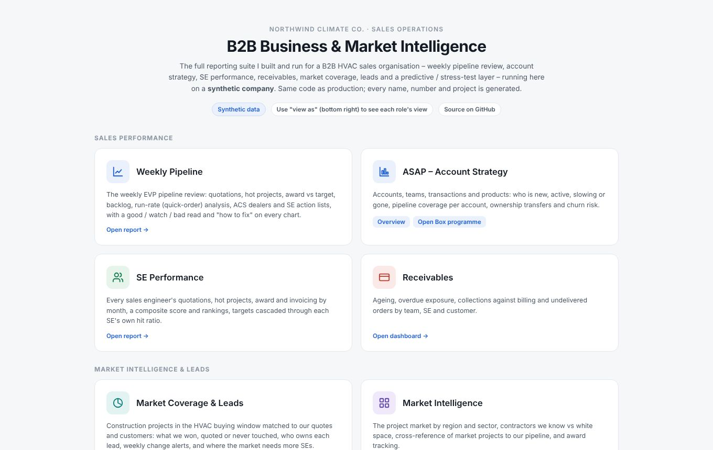
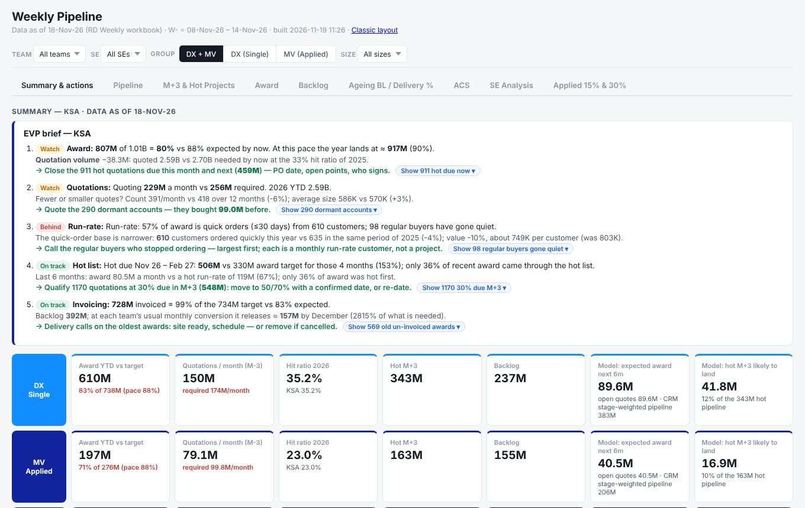
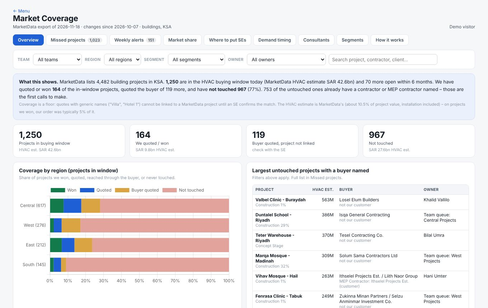
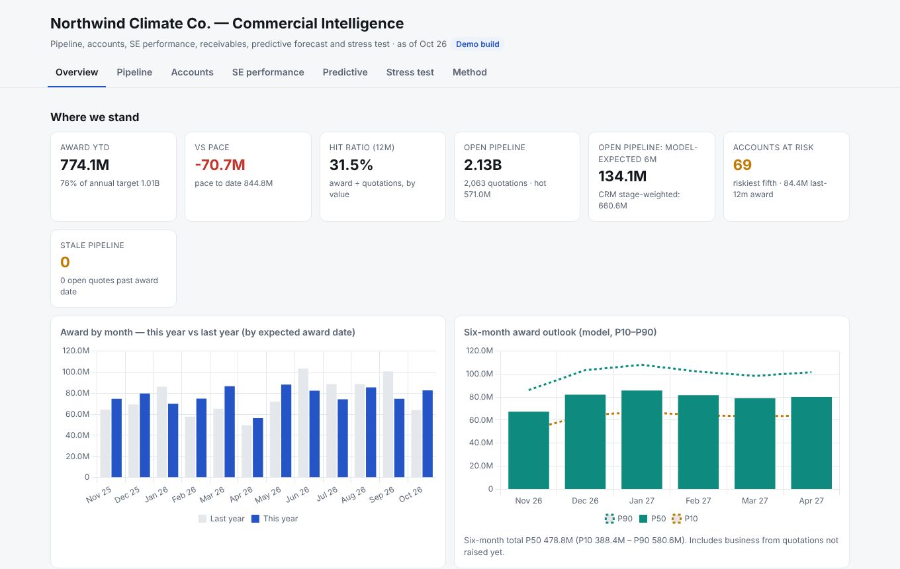

# B2B Business & Market Intelligence — pipeline, accounts, SE performance, receivables, market coverage, forecasting

**Live demo:** https://daeeabdulhaseeb.github.io/commercial-intelligence/ (synthetic company)

The complete reporting suite I built and run for a B2B HVAC sales organisation (project and dealer channels, seven
regional sales teams), rebuilt weekly from ERP / CRM extracts and published as static web
reports. The demo runs **the same report builders** on a fictional company, *Northwind Climate Co.*: every customer,
salesperson, project and number is generated.



| Report | Business question it answers |
|---|---|
| **Weekly Pipeline** | Are we on pace for target? Is there enough quoted and hot? Who has to quote, close or deliver what this week? EVP brief, run-rate (quick-order) analysis, hot list, backlog conversion, dealer programme, SE action lists, with a good / watch / bad read and "how to fix" on each chart |
| **ASAP – Account Strategy** | Which accounts are new, active, slowing or gone; pipeline coverage per account; ownership transfers; released-accounts (reactivation) programme and watch list; churn risk |
| **SE Performance** | Each sales engineer's quotations, hot projects, award and invoicing by month; composite score; targets cascaded through each SE's own hit ratio |
| **Receivables** | Ageing, overdue exposure, collections vs billing, DSO, undelivered orders by team / SE / customer |
| **Market Coverage & Leads** | Which construction projects are in the HVAC buying window, which we won, quoted or never touched, who owns each lead, what changed this week, and where the market needs more SEs |
| **Market Intelligence** | The project market by region and sector, known contractors vs white space, market projects cross-referenced to our pipeline, contractor award tracker |
| **Forecast & Stress Test** | Win-probability model vs CRM stage, Monte Carlo award forecast with backtests, churn model, next-best actions, interactive stress test |

Each report respects the viewer's role (EVP / sales ops see everything, a manager their team); in the demo the
"view as" switch shows each view. In production the site sits behind company e-mail sign-in with an access log.




### How the demo is built

A local generator (kept out of this repository, because it reproduces the private extract layouts) simulates customers (loyalty, payment habit, churn), sales engineers (skill, joining / leaving),
quotations with stage paths, award-date slippage and quick orders, invoicing against backlog, receivables and
collections, ownership transfers and a construction-project market, and writes them in the layouts of the real
extracts (C4C pipeline lines and monthly snapshots, invoicing, customer master, AR ageing, collections, project
database export). The build then runs the production builders (kept in a private repository) on that data with
git disabled and a demo sign-in, re-brands the pages, renames internal programme labels, and assembles `docs/`.
`scan_public.py` checks every published file against the private protected-term list before anything is pushed.

## The predictive layer

### What it does

| Tab | Business question | How |
|---|---|---|
| **Pipeline** | Are we on pace? Is the pipeline big and hot enough? | Award vs target pace, hit ratio, quotations needed per month, open pipeline by stage, stale quotations, team table, top deals by model-expected value |
| **Leads** | Which channels convert, where do leads leak? | Lead → quotation → award funnel by channel and temperature, routing gaps, leakage to competitors |
| **Accounts** | Who is growing, slowing or gone? | New / Active / Slowing / Dormant status, accounts at risk (churn model), win-back list, ownership transfers |
| **SE performance** | Who is delivering, and on what? | Scorecard: quotation 20% + hot-project-to-award 30% + award 20% + invoicing 30%, targets cascaded through each salesperson's hit ratio |
| **Receivables** | How much cash is stuck, with whom? | Ageing by days past due, DSO, billing vs collections trend, largest overdue customers, overdue by salesperson |
| **Predictive** | What will we actually win? | Win-probability model vs CRM stage %, calibration, drivers, forecast backtests, churn model, next-best actions |
| **Stress test** | What if the market turns? | Live Monte Carlo in the browser: win-rate shock, fewer new projects, delays of the biggest customers, losing the largest deals, slower payments → award, invoicing, cash and year-end target gap |

### Results on the demo company (out-of-time)

| | Model | CRM stage % |
|---|---|---|
| Ranking quality, 6-month win (AUC) | **0.89** | 0.71 |
| Probability error (Brier, lower is better) | **0.093** | 0.152 |
| Expected value vs value actually won (test window) | **1.26×** | 3.29× |
| 6-month award forecast (P50) vs actual, 3 backtests | **−4%, +9%, +38%** | |

The churn model ranks accounts that go quiet within six months with AUC 0.70 (simple recency rule: 0.67).

On a real two-year history of monthly pipeline snapshots the gap between model and CRM stage was considerably
larger than on this demo — stage percentages that are not maintained rigorously carry little signal, while the
age of a quotation, award-date slips and the customer's track record carry a lot.



## Method

**Data model.** Everything downstream reads one canonical schema (`ci/schema.py`): monthly quotation snapshots
(stage, value, expected award date, owner, customer), invoices with due and paid dates, leads, and account
ownership history. Adapters (`ci/adapters.py`) map an ERP / CRM extract to it; nothing company-specific is in code.

**Business rules.** Award = 90/100% quotations dated by expected award date. Hit ratio = award ÷ value of
quotations raised (tender / budget quotations excluded), any status including lost. Hot = 50/70%. Quotations
needed per month = award target ÷ hit ratio ÷ 12, with each salesperson's hit ratio bounded to 0.5–2× the
company's.

**Win probability** (`ci/models.py`). Gradient-boosted trees on every *(open quotation × month-end snapshot)*:
stage, size, age, months in stage, stage moves, award-date slips, months to the award date, product, team,
region, month of year, and the customer's and salesperson's win record *as known at that date* (no look-ahead).
Target: awarded within 6 months. Trained on older snapshots, tested on later ones.

**Forecast.** Monte Carlo over open quotations: each is won with its model probability, lands in a month drawn
from the empirical award-timing distribution (conditional on months to the expected award date), plus the
recent run-rate of business from quotations not yet raised, with a common market shock so risk is correlated.
Backtested from several past dates using only information visible at the time.

**Churn.** Account-month panel (recency of quotations and awards, quotation trend, award trend, payment
lateness) → probability of no quotation and no award in the next six months.

**Next best actions.** Close likely deals due soon; re-qualify large deals where the CRM stage is far more
optimistic than the model; visit valuable accounts at risk; collect overdue cash from customers who have live
pipeline (before the next award).

**Stress test.** The same simulation, re-run in the browser with scenario levers; invoicing follows the
historical award-to-invoice profile, cash the invoice-to-payment profile, current receivables each customer's
payment habit; slower payments phase in over three months.

**Synthetic data** (`ci/synth.py`). 1,200 customers, 24 sales engineers in 8 teams, ~13k quotations over 28
monthly snapshots, ~9k invoices, ~5k leads. Hidden customer loyalty, payment habit and salesperson skill drive a
monthly stage-transition model with seasonality, award-date slippage, ageing, customer fade-out before churn,
delivery-based invoicing and credit-term-based payment.

## Run it

```bash
pip install -r requirements.txt
python -m ci.synth          # generate the synthetic company (seeded, deterministic)
python -m ci.build          # this layer on its own -> docs/model/index.html
```

## Running on real data

```bash
cp private.example.json private/config.json   # map your extract's column names; private/ is git-ignored
python -m ci.build --private private/config.json   # -> private/site/index.html, never committed
python scan_public.py --refresh private/config.json
python scan_public.py       # pre-push check: fails if any customer / salesperson / project name or protected
                            # term from the private data appears in a public file
```

## Layout

```
ci/schema.py      canonical data model          ci/analytics.py   KPIs per tab
ci/synth.py       synthetic company generator   ci/models.py      win probability, forecast, churn, actions
ci/adapters.py    ERP / CRM extract -> schema   ci/build.py       build pipeline + HTML rendering
ci/template.html  dashboard (vanilla JS + Chart.js)                docs/              GitHub Pages output (the suite)
scan_public.py    pre-push privacy scan          data/synthetic/   generated demo data
```

## Limits

Six-month horizon for deal-level predictions (longer cycles are covered by the run-rate). Model quality depends
on CRM discipline. Two years of monthly snapshots give only a handful of backtests — treat P10–P90 as indicative.

---
Mohammed Abdul Haseeb · [LinkedIn](https://www.linkedin.com/in/daeeabdul) · MIT licence (Chart.js © Chart.js
contributors, MIT).
