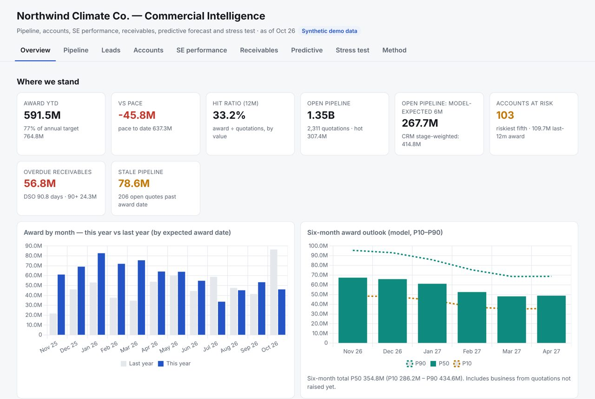
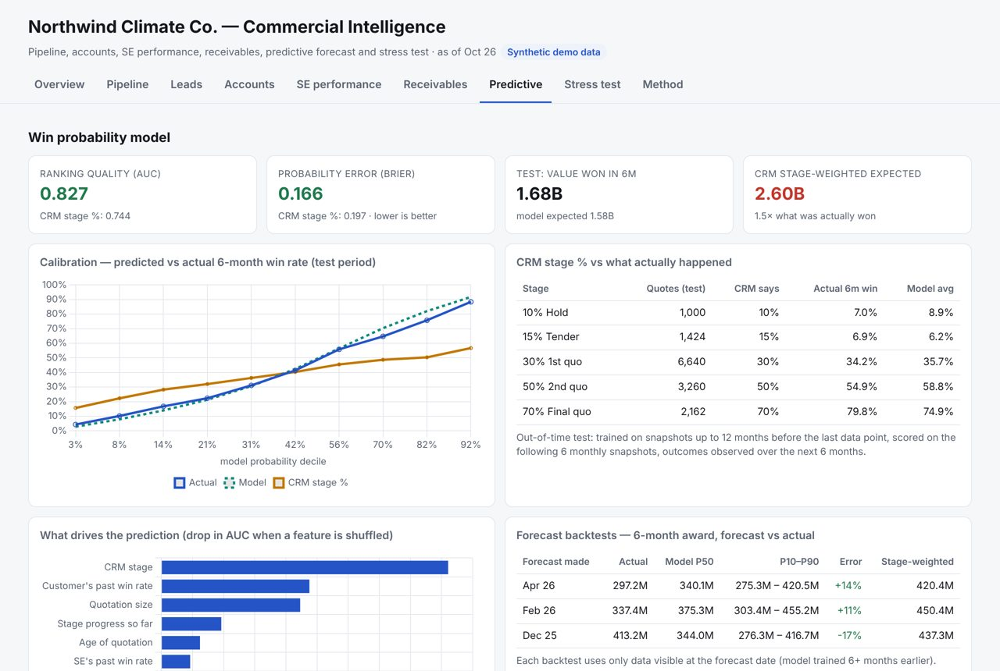

# Commercial Intelligence — pipeline, accounts, receivables, predictive forecasting and stress testing

**Live demo:** https://daeeabdulhaseeb.github.io/commercial-intelligence/ (synthetic data)

A working commercial-intelligence stack for a B2B sales organisation (project and dealer channels, multi-region
sales teams), built from the reporting and planning cycle I run in my day job: weekly pipeline reviews,
salesperson scorecards, account reactivation and receivables follow-up. On top of the descriptive layer it adds
the parts most sales reporting lacks: **a win-probability model, a Monte Carlo award forecast with ranges, an
account-churn model, next-best actions per salesperson and an interactive stress test.**

All data in this repository is **synthetic**: a fictional company (*Northwind Climate Co.*) simulated with a small
behavioural model. The same code runs on a company's own CRM / ERP extracts through a private configuration that
never leaves the machine (see *Running on real data*).



## What it does

| Tab | Business question | How |
|---|---|---|
| **Pipeline** | Are we on pace? Is the pipeline big and hot enough? | Award vs target pace, hit ratio, quotations needed per month, open pipeline by stage, stale quotations, team table, top deals by model-expected value |
| **Leads** | Which channels convert, where do leads leak? | Lead → quotation → award funnel by channel and temperature, routing gaps, leakage to competitors |
| **Accounts** | Who is growing, slowing or gone? | New / Active / Slowing / Dormant status, accounts at risk (churn model), win-back list, ownership transfers |
| **SE performance** | Who is delivering, and on what? | Scorecard: quotation 20% + hot-project-to-award 30% + award 20% + invoicing 30%, targets cascaded through each salesperson's hit ratio |
| **Receivables** | How much cash is stuck, with whom? | Ageing by days past due, DSO, billing vs collections trend, largest overdue customers, overdue by salesperson |
| **Predictive** | What will we actually win? | Win-probability model vs CRM stage %, calibration, drivers, forecast backtests, churn model, next-best actions |
| **Stress test** | What if the market turns? | Live Monte Carlo in the browser: win-rate shock, fewer new projects, delays of the biggest customers, losing the largest deals, slower payments → award, invoicing, cash and year-end target gap |

## Results on the demo data (out-of-time)

| | Model | CRM stage % |
|---|---|---|
| Ranking quality, 6-month win (AUC) | **0.83** | 0.74 |
| Probability error (Brier, lower is better) | **0.166** | 0.197 |
| Expected value vs value actually won (test window) | **0.94×** | 1.55× |
| 6-month award forecast error, 3 backtests | **+14%, +11%, −17%** | +41%, +33%, +6% |

The churn model ranks accounts that go quiet within six months with AUC 0.86; the riskiest fifth of active accounts
contains 57% of those that actually go quiet.

On a real two-year history of monthly pipeline snapshots the gap between model and CRM stage was considerably
larger than on this demo — stage percentages that are not maintained rigorously carry little signal, while the
age of a quotation, award-date slips and the customer's track record carry a lot.



## Method

**Data model.** Everything downstream reads one canonical schema (`ci/schema.py`): monthly quotation snapshots
(stage, value, expected award date, owner, customer), invoices with due and paid dates, leads, and account
ownership history. Adapters (`ci/adapters.py`) map an ERP / CRM extract to it; nothing company-specific is in code.

**Business rules.** Award = 90/100% quotations dated by expected award date. Hit ratio = award ÷ value of
quotations raised (tender / budget quotations excluded), any status including lost. Hot = 50/70%. Quotations
needed per month = award target ÷ hit ratio ÷ 12, with each salesperson's hit ratio bounded to 0.5–2× the
company's.

**Win probability** (`ci/models.py`). Gradient-boosted trees on every *(open quotation × month-end snapshot)*:
stage, size, age, months in stage, stage moves, award-date slips, months to the award date, product, team,
region, month of year, and the customer's and salesperson's win record *as known at that date* (no look-ahead).
Target: awarded within 6 months. Trained on older snapshots, tested on later ones.

**Forecast.** Monte Carlo over open quotations: each is won with its model probability, lands in a month drawn
from the empirical award-timing distribution (conditional on months to the expected award date), plus the
recent run-rate of business from quotations not yet raised, with a common market shock so risk is correlated.
Backtested from several past dates using only information visible at the time.

**Churn.** Account-month panel (recency of quotations and awards, quotation trend, award trend, payment
lateness) → probability of no quotation and no award in the next six months.

**Next best actions.** Close likely deals due soon; re-qualify large deals where the CRM stage is far more
optimistic than the model; visit valuable accounts at risk; collect overdue cash from customers who have live
pipeline (before the next award).

**Stress test.** The same simulation, re-run in the browser with scenario levers; invoicing follows the
historical award-to-invoice profile, cash the invoice-to-payment profile, current receivables each customer's
payment habit; slower payments phase in over three months.

**Synthetic data** (`ci/synth.py`). 1,200 customers, 24 sales engineers in 8 teams, ~13k quotations over 28
monthly snapshots, ~9k invoices, ~5k leads. Hidden customer loyalty, payment habit and salesperson skill drive a
monthly stage-transition model with seasonality, award-date slippage, ageing, customer fade-out before churn,
delivery-based invoicing and credit-term-based payment.

## Run it

```bash
pip install -r requirements.txt
python -m ci.synth          # generate the synthetic company (seeded, deterministic)
python -m ci.build          # models + dashboard -> docs/index.html
```

## Running on real data

```bash
cp private.example.json private/config.json   # map your extract's column names; private/ is git-ignored
python -m ci.build --private private/config.json   # -> private/site/index.html, never committed
python scan_public.py --refresh private/config.json
python scan_public.py       # pre-push check: fails if any customer / salesperson / project name or protected
                            # term from the private data appears in a public file
```

## Layout

```
ci/schema.py      canonical data model          ci/analytics.py   KPIs per tab
ci/synth.py       synthetic company generator   ci/models.py      win probability, forecast, churn, actions
ci/adapters.py    ERP / CRM extract -> schema   ci/build.py       build pipeline + HTML rendering
ci/template.html  dashboard (vanilla JS + Chart.js)                docs/              GitHub Pages output
scan_public.py    pre-push privacy scan          data/synthetic/   generated demo data
```

## Limits

Six-month horizon for deal-level predictions (longer cycles are covered by the run-rate). Model quality depends
on CRM discipline. Two years of monthly snapshots give only a handful of backtests — treat P10–P90 as indicative.

---
Mohammed Abdul Haseeb · [LinkedIn](https://www.linkedin.com/in/daeeabdul) · MIT licence (Chart.js © Chart.js
contributors, MIT).
